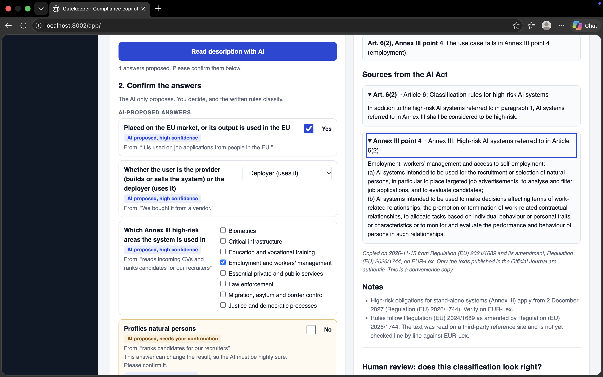
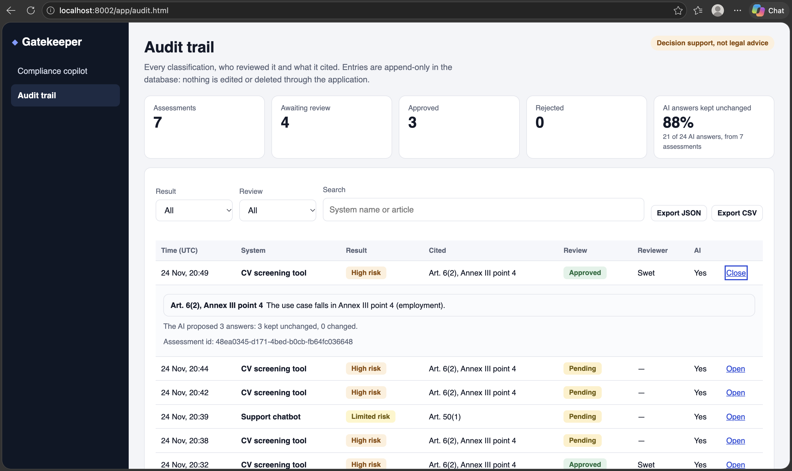
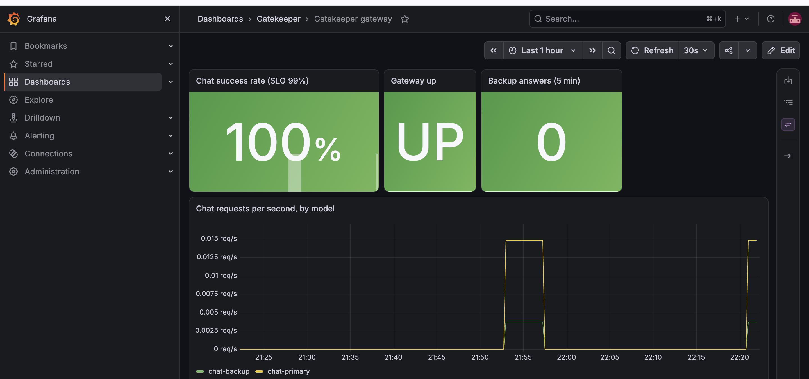

# Gatekeeper
[](https://github.com/nisha1805/gatekeeper/actions/workflows/ci.yml)

An AI gateway with EU AI Act compliance workflows, built as a hands-on portfolio project.

**Status: work in progress. Prototype only, no real users.** Nothing here is production-ready.

## See it in 1 minute


https://github.com/user-attachments/assets/7bb69343-62dc-4cfb-98e9-61ee73ee5166


The 43-second demo above (no sound) shows: describe an invented AI system, the AI proposes answers with quotes, a person confirms, written rules decide the risk tier, and the result cites the article text. Every classification lands in an append-only audit trail. The video file is also in [docs/gatekeeper-demo.mp4](docs/gatekeeper-demo.mp4) for download.





There is no public live demo yet. To run it yourself, see [Quick start](#quick-start).

## The problem

When several teams add AI features, three things get out of control: cost (nobody knows what an answer costs), quality (prompts and models change without measurement) and compliance (EU AI Act duties need classification and evidence). See [the problem brief](docs/product/problem-brief.md) and [the case study](docs/case-study.md).

## What works today

**Platform**
- One `terraform apply` builds a local Kubernetes cluster (kind), creates namespaces and installs Argo CD. Argo CD watches this repo, so a change pushed to `deploy/` reaches the cluster without running `kubectl`.
- A sample app is packaged as a Helm chart and deployed twice: dev (1 replica) and prod (2 replicas).
- A Kyverno policy rejects containers that do not run as non-root, in the sample namespaces and in the gateway namespace.
- I tested a full destroy and rebuild: all applications and the policy came back from Git on their own.

**Gateway**
- LiteLLM runs in the cluster with its own Postgres, delivered through Argo CD with pinned versions, and runs as a non-root user.
- Two models sit behind one door: `chat-primary` (Claude Haiku) and `chat-backup` (Claude Sonnet). If the primary fails, the gateway retries once and then falls back.
- Each team has its own virtual key and budget. In a test, a team with a tiny budget was blocked after a few requests while another team kept working. Enforcement overshot by about 18 percent, so budgets are a guard rail, not an exact limit.
- `scripts/smoke-test.sh` checks the whole gateway in one command.
- API keys never enter Git. They live in git-ignored local files, and a script loads them into the cluster.

**Pipeline**
- GitHub Actions runs five jobs on every push: a gitleaks scan of the full history, Terraform format and validate, Helm lint for both charts, the API tests (191) against a throwaway Postgres, and the UI tests (10) plus the logic tests of the web pages (23, run with Node).
- Third-party actions are avoided. The only one used is GitHub's own checkout, pinned to an exact commit, and tools are installed at pinned versions. Trivy is not added yet: I want to install a pinned, checksum-verified release rather than trust a version tag.

**Monitoring**
- The gateway exposes Prometheus metrics on a dedicated in-cluster port. A small Prometheus scrapes them, and Grafana shows a dashboard that is provisioned from Git.
- A written service level objective (99% of eligible chat requests succeed) with three alerts: success rate, metrics target down, and backup model in use.
- I tested the alerts with real failures: a pod kill (recovery in about 45 seconds), a broken primary model (the fallback alert fired and cleared), and both models broken. The last drill found a bug in my success-rate rule, which I fixed. The fix was checked by replaying recorded data, not yet by firing live. See [the SLO notes](docs/engineering/slo.md) and [the runbook](docs/engineering/runbook.md).



**Compliance module (prototype)**
- The EU AI Act classifier is a set of written rules, not a model. Each result names the articles it used, and 15 tests pin the rules down. On 24 November 2026 I compared the wording of every rule by hand with the EUR-Lex text. Exceptions are simplified and application dates are not checked.
- A web API classifies a described system, stores every result, and records a reviewer's approve or reject decision. Misspelled fields are rejected instead of ignored.
- Results and reviews go into an append-only Postgres audit log. The application's database user can only read and add rows, triggers block changes for everyone else, and tests prove the refusals, in CI as well. A database administrator could still switch triggers off.
- The reviewer name is typed, not authenticated. There is no login.
- A real web page, served by the API at `/app/`, walks through describe, AI-proposed answers, confirmation, result with cited articles and explanation, and a human review that is saved in the audit log. A second page, the audit trail, lists every assessment with its result, cited articles, review and whether the AI was used, with filters, export to JSON and CSV (formula-safe), and the share of AI answers people kept unchanged. The pages use no framework and no inline scripts, and the server sets a strict Content-Security-Policy.
- The compliance service runs in the cluster, deployed by Argo CD from a Helm chart: its own Postgres, a Job that creates the tables and the restricted database role, and the service as a non-root container with a read-only filesystem. CI builds the image, checks that it runs as non-root and answers, and pushes it to GHCR tagged with the commit. The service calls the in-cluster gateway with its own team key. In the cluster I checked that the application's database user is refused when it tries to update or delete audit rows, and that a stored assessment was still there after I deleted the database and service pods.
- A two-page Streamlit interface (copilot and audit trail) also calls the API. It is a test harness.
- The AI step is described below.

## AI in Gatekeeper

Where AI is used, what it is allowed to decide, and what is not built yet.

**The AI never decides the compliance result.** Written rules decide the risk tier, so the same answers always give the same result and every result cites the articles it used. The AI helps with reading and writing text, and a person confirms.

| Part | What it does | Status |
| --- | --- | --- |
| AI gateway (LiteLLM, configured by me, not written by me) | One door for all model calls, with a key and a budget per team. Claude Haiku answers, and Claude Sonnet takes over if it fails | Built and tested |
| Outage drills | I broke the primary model on purpose and checked that the backup answered and that an alert fired and cleared | Done, evidence in the logbook |
| AI monitoring | Requests per model, failures, backup use, a written 99% target and three alerts, in Prometheus and Grafana | Built |
| Answer proposals from free text | `POST /extractions` sends a description through the gateway, and the model proposes answers to the questionnaire, each with a quote from the description | Built, checked on a real model |
| AI-written explanation using only the cited articles | `POST /assessments/{id}/explanation`: the model explains the result, and the code rejects any mention of an article, paragraph or annex point the rules did not cite, or any year. A fixed template is used if the AI fails or is rejected | Built. Tested with a fake model and run on a real one (Claude Haiku through the gateway). The checker can be stricter than needed for minimal-risk systems, and then the template is shown |
| AI proposals stored next to the final answers | `POST /extractions` saves the proposals (not the description, only its hash) in an append-only table. `GET /assessments/{id}/ai-agreement` and `GET /ai-agreement` show how often people kept the AI's answers unchanged | Built and tested, including on Postgres |
| Exact article text under "Sources" | `GET /assessments/{id}/sources` returns the exact wording of every article the rules cited, copied by a script from EUR-Lex (Regulation 2024/1689 and its amendment 2026/1744) with a SHA-256 fingerprint per text. No AI is involved, and the result page shows it under each result | Built and tested. It is a convenience copy: only the Official Journal text is authentic. Paragraphs are copied only for the cited provisions, and the copy is not refreshed automatically |
| Vector search over the whole AI Act | Retrieval for free-text questions about the Act | Not built, on purpose: the cited articles come from an exact lookup, the text set is small (26 provisions), and free-text legal questions drift towards legal advice. A candidate for a separate project |
| Personal-data masking, instruction check and rate limiting | E-mail addresses, IBANs, card numbers and phone numbers are masked before the AI reads the text. Instruction-like text switches off all pre-filling. The two AI endpoints are limited per client and overall | Built, minimal. Names and addresses are not detected, and the limits are per process and reset on restart |
| Quality gate in CI for the AI step | A test set that blocks a release if answers get worse | Planned |
| Langfuse traces | Cloud tier, synthetic data only | Planned |
| LangChain, agents, fine-tuning | | Not used |

### How the proposal step is kept safe

- The model only proposes. A person confirms, and the rules decide the tier.
- Every proposal must quote the description. The code checks that the quote really is in the text, and pre-fills nothing otherwise.
- The model must answer in a fixed JSON shape. Unknown fields, wrong types and duplicates are dropped and counted.
- Answers that can change the result (Annex III areas, profiling, the exceptions) are pre-filled only when the model is highly sure.
- Prohibited practices and "outside the EU" are never pre-filled, so a prompt injection cannot produce a banned result without a person.
- Text that looks like an instruction to the AI (for example "ignore all previous instructions") switches off all pre-filling, so a person confirms every answer. This is a simple pattern check and will not catch every attempt.
- The prompt tells the model that the description is untrusted data. Descriptions are limited to 4000 characters. Enter synthetic or public data only.
- Gateway errors are reported without the key, and nothing is guessed when the model fails.

### How it is tested

38 tests cover the step with a fake gateway, so no paid call is needed: quote checking, wrong types, duplicates, prompt injection, the confidence rules and the gateway client. A live run on the real model found something the fake could not: the newer Claude model rejects `temperature: 0`, so answers can vary between runs. That is why no answer is trusted without a verified quote and a person's confirmation.

## What is not built yet

Planned: a quality gate for the AI step in CI, Langfuse traces, a login with review roles, a public live demo, and user interviews. Each is listed above only once it works.

## Quick start

You need Docker Desktop (running, with about 5 GiB of memory), Terraform, kubectl, Helm and an Anthropic API key. Put your own key in a local `.env` file (see `scripts/create-secrets.sh` for the names it reads).

```
git clone https://github.com/nisha1805/gatekeeper.git
cd gatekeeper/infra
terraform init
terraform apply
cd ..
export KUBECONFIG="$PWD/infra/gatekeeper.kubeconfig"
./scripts/create-secrets.sh
kubectl -n argocd get applications
```

The first run takes 5 to 10 minutes. Then, with `kubectl -n gateway port-forward svc/litellm 4000:4000` running in another window:

```
./scripts/seed-teams.sh
./scripts/smoke-test.sh
```

Then the compliance service: `./scripts/create-compliance-secrets.sh` creates its secret (random database passwords, plus the `compliance-service` key from `.env.teams`), Argo CD deploys it, and `kubectl -n compliance port-forward svc/compliance 8002:8000` serves it at `http://localhost:8002/`.

Tested on an Apple-silicon Mac with 8 GB of memory only. On a machine that size, close other heavy apps while the cluster runs.

## Inspired by and built on

Tools I use, and what for. Licences, and what I checked, are in [docs/third-party-licences.md](docs/third-party-licences.md). This project is not related to the Open Policy Agent "Gatekeeper" for Kubernetes.

- LiteLLM: the gateway (keys, budgets, routing, fallback). I configure and test it. I did not write it.
- Anthropic Claude models (Haiku and Sonnet), through the API: the gateway's models and the AI step
- Argo CD: GitOps delivery
- kind and the tehcyx kind Terraform provider: local cluster
- Terraform, Helm: infrastructure and packaging
- Kyverno: policy as code
- PostgreSQL: the gateway's database and the append-only audit log
- Prometheus and Grafana (community chart): metrics, alerts and the dashboard
- FastAPI, pydantic, uvicorn and psycopg: the compliance API and its storage
- Streamlit: the current test interface
- pytest: all tests
- gitleaks: scans commits and the full history for secrets
- GitHub Actions: CI. The only third-party action used is GitHub's own checkout, pinned to a commit
- Docker: runs the local cluster and a throwaway Postgres
- The law: Regulation (EU) 2024/1689 as amended by Regulation (EU) 2026/1744, source EUR-Lex (https://eur-lex.europa.eu), reused with credit under the Commission's CC BY 4.0 reuse terms. Changes: split into single provisions, formatting removed, added text marked. The article texts shown under Sources are copied from EUR-Lex, and I compared each rule's wording with them by hand on 24 November 2026. Only the Official Journal text is authentic, and I am not a lawyer.
- Other open-source projects also classify AI systems under the EU AI Act. I looked only at their READMEs and copied no code.

## Honesty notes

- Public and synthetic data only. Nothing from any employer.
- This is decision support, not legal advice.
- I will only claim what I have built, and only report numbers I can reproduce.

## Licence

MIT. See [LICENSE](LICENSE).
