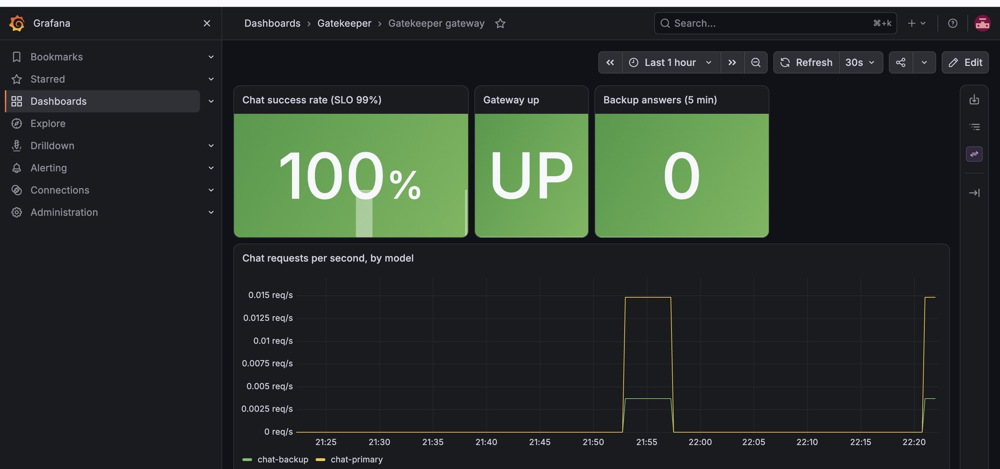

# Gatekeeper
[](https://github.com/nisha1805/gatekeeper/actions/workflows/ci.yml)

An AI gateway with EU AI Act compliance workflows, built as a hands-on portfolio project.

**Status: work in progress. Prototype only, no real users.** Nothing here is production-ready.

## The problem

When several teams add AI features, three things get out of control: cost (nobody knows what an answer costs), quality (prompts and models change without measurement) and compliance (EU AI Act duties need classification and evidence). See [the problem brief](docs/product/problem-brief.md).

## What works today
**Pipeline**
**Monitoring**
- The gateway exposes Prometheus metrics on a dedicated in-cluster port. A small Prometheus scrapes them, and Grafana shows a dashboard that is provisioned from Git.
- A written service level objective (99% of eligible chat requests succeed) with three alerts: success rate, metrics target down, and backup model in use.
- I tested the alerts with real failures: a pod kill (recovery in about 45 seconds), a broken primary model (the fallback alert fired and cleared), and both models broken. The last drill found a bug in my success-rate rule, which I fixed. The fix was checked by replaying recorded data, not yet by firing live. See [the SLO notes](docs/engineering/slo.md) and [the runbook](docs/engineering/runbook.md).


## What is not built yet

Observability and SLOs, the evaluation gate in CI, the compliance module, guardrails and the product documents. Each is planned and will be listed above only once it works.

## Quick start

You need Docker Desktop (running, with about 5 GiB of memory), Terraform, kubectl, Helm and an Anthropic API key. Put your own key in a local `.env` file (see `scripts/create-secrets.sh` for the names it reads).

```
git clone https://github.com/nisha1805/gatekeeper.git
cd gatekeeper/infra
terraform init
terraform apply
cd ..
export KUBECONFIG="$PWD/infra/gatekeeper.kubeconfig"
./scripts/create-secrets.sh
kubectl -n argocd get applications
```

The first run takes 5 to 10 minutes. Then, with `kubectl -n gateway port-forward svc/litellm 4000:4000` running in another window:

```
./scripts/seed-teams.sh
./scripts/smoke-test.sh
```

Tested on an Apple-silicon Mac with 8 GB of memory only. On a machine that size, close other heavy apps while the cluster runs.

## Inspired by and built on

Tools I use, and what for. Licences will be checked and listed here before the project is published.

- LiteLLM: the gateway (keys, budgets, routing, fallback). I configure and test it. I did not write it.
- Anthropic Claude models, through the API
- Argo CD: GitOps delivery
- kind and the tehcyx kind Terraform provider: local cluster
- Terraform, Helm: infrastructure and packaging
- Kyverno: policy as code
- PostgreSQL: the gateway's database
- gitleaks: scans commits for secrets

## Honesty notes

- Public and synthetic data only. Nothing from any employer.
- This is decision support, not legal advice.
- I will only claim what I have built, and only report numbers I can reproduce.

## Licence

MIT. See [LICENSE](LICENSE).