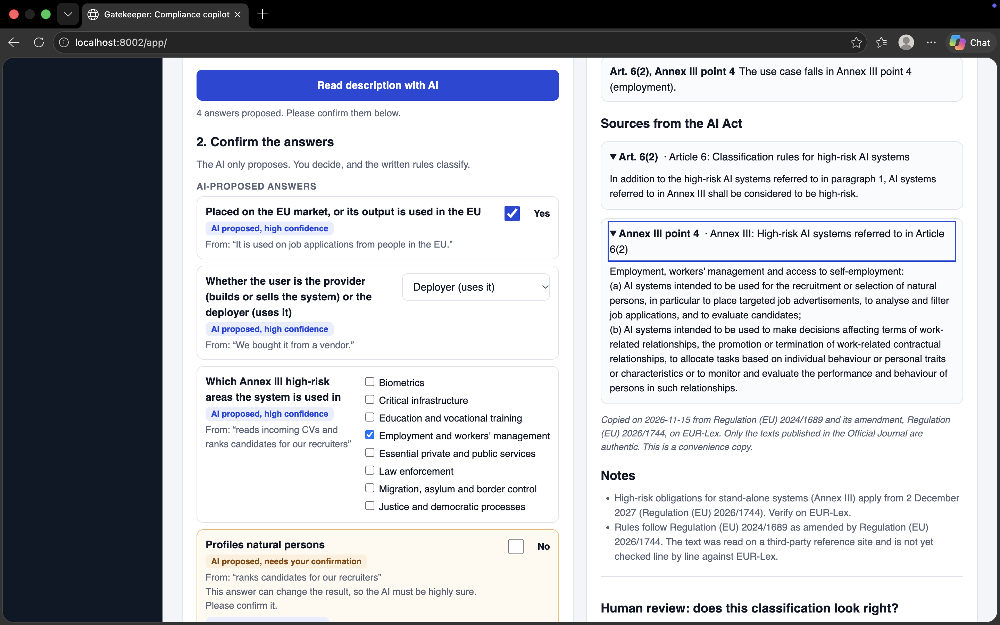

# Case study: Gatekeeper

*A prototype I built alone to show how I run AI features safely: platform first, AI second, product third. Public and synthetic data only. Not legal advice.*

## The problem

When several teams in a company add AI features, three things get out of control at once:

- **Cost**: nobody knows what an answer costs or who spent the budget.
- **Quality**: prompts and models change without anyone measuring the effect.
- **Compliance**: the EU AI Act asks for a risk classification and evidence for every AI system, and most teams have neither.

Gatekeeper is my answer to all three, in one small system. The longer version is in [the problem brief](product/problem-brief.md).

## Who it is for (a hypothesis, not yet validated)

A product owner or compliance lead in a company with several AI features, who has to answer "which of our AI systems are high-risk, who checked, and on what basis?" and has no tool for it. The platform side is for the engineers who run those features.

I have not interviewed any users. This is the biggest gap in the product side of the project, and I say so rather than pretend otherwise.

## What I built

**1. A platform (my main focus).** One `terraform apply` builds a local Kubernetes cluster and installs Argo CD, which then deploys everything from Git. Pipeline, policy and monitoring are part of it:

- A LiteLLM gateway (configured by me, not written by me) gives every team one door to Claude Haiku, with Claude Sonnet as backup, and a key and budget per team.
- Kyverno rejects containers that run as root. GitHub Actions runs a secret scan, Terraform and Helm checks, and the tests on every push, and builds and publishes the compliance image.
- Prometheus and Grafana show requests, failures and backup use, with a written 99% target and three alerts.

**2. A compliance module (the product).** A person describes an AI system in plain words. The AI proposes answers to a questionnaire, each with a quote from the description. The person confirms. Written rules, not the AI, decide the risk tier, and the result cites the articles it used and shows their exact text from EUR-Lex. Every classification goes into an append-only audit trail.

**3. An AI step with limits.** The AI reads text and writes an explanation. It never decides the result.

## Decisions and why

| Decision | Why |
| --- | --- |
| **Rules decide the tier, not a model** | The same answers must always give the same result, and every result must name its articles. A model cannot promise that. |
| **The AI only proposes, and a person confirms** | Each proposal needs a quote that really appears in the description, or nothing is pre-filled. Prohibited practices and "outside the EU" are never pre-filled, so a prompt injection cannot produce a banned result without a person. |
| **Append-only audit log, enforced by the database** | The application's database user can only read and add rows, and triggers block changes for everyone else. A rule in the application code alone could be bypassed. |
| **Exact article text from EUR-Lex, no AI** | A recruiter or a lawyer should see the real wording, not a summary. Each text has a SHA-256 fingerprint. |
| **Use a gateway instead of building one** | The gateway is not the interesting part. Running it safely is: budgets, fallback, keys outside Git, monitoring, drills. |
| **No RAG (vector search)** | The cited articles come from an exact lookup, there are only 26 provisions, and free-text legal questions drift towards legal advice. It may become a separate project. |

## What I tested, and what I found

I only list things I ran myself.

- **Rebuild from Git.** I destroyed and rebuilt the whole cluster. All applications and the policy came back on their own.
- **Budgets.** A team with a tiny budget was blocked after a few requests while another team kept working. Enforcement overshot by about 18%, so budgets are a guard rail, not an exact limit.
- **Outage drills.** Killing a pod recovered in about 45 seconds. Breaking the primary model made the backup answer, and the fallback alert fired and cleared. Breaking both models exposed a bug in my success-rate alert rule. I fixed it and checked the fix by replaying recorded data, not yet with a live failure.
- **Audit log.** In the cluster, the application's database user was refused when it tried to update or delete audit rows. An entry from 16 November was still there on 24 November, after the pods had been restarted.
- **A real model found what the fake could not.** The AI step has 38 tests with a fake model. A live run showed that the newer Claude model rejects `temperature: 0`, so answers can vary between runs. This is why nothing is trusted without a verified quote and a person's confirmation.
- **Rules against the law.** On 24 November I compared the wording of every rule by hand with the EUR-Lex text, and a test now checks that every cited article exists in that copy. I also keep 21 invented cases with a stated expected tier, and all 21 agree with the rules. That checks that the rules are consistent. It does not measure the AI.

## What went wrong along the way

- The success-rate alert was wrong until a drill showed it (above).
- My first container could not read its own files, because they were copied in with restrictive permissions. I fixed it in the image build and added a CI check that the container runs as non-root and answers.
- I assumed a free public demo was possible and it was not, so there is no live demo. The video and screenshots in the README show it instead.

## Limits (please read)

- It is a prototype with no real users. Nothing here is production-ready, and it is decision support, not legal advice.
- There is no login: the reviewer name is typed in. A database administrator could still switch the triggers off.
- The rules simplify the law. Some exceptions are not modelled, and application dates are not checked. The result page says so.
- The AI step has no quality score yet. The "answers kept unchanged" figure on the audit page comes from my own few test runs, so it says nothing about accuracy.
- Personal-data masking is minimal: names and addresses are not detected. Rate limits reset on restart.
- It was tested on one Apple-silicon Mac with 8 GB of memory.

## What I would do next

1. Talk to people who handle AI compliance, and change the questionnaire based on what they say.
2. Add a quality gate: score the AI's proposals against the 21 cases and block a release if they get worse.
3. Add a real login and review roles.
4. Show a public demo, once I find a free and safe way to host it.

Code, tests and run instructions are in the [README](../README.md).
